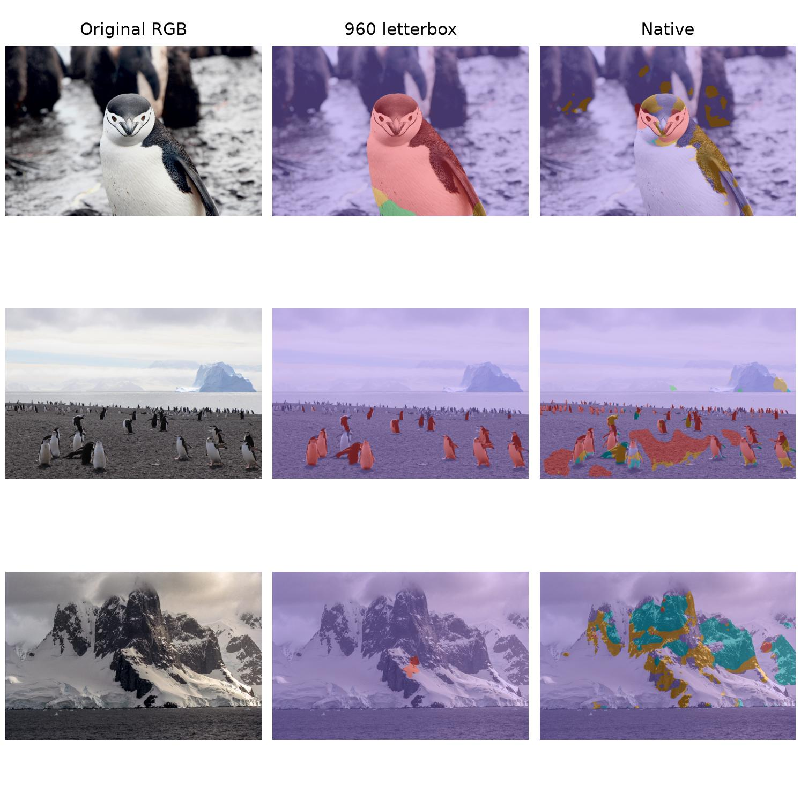

# Antarctic Animal Segmentation

A hand-written ResNet34 U-Net in PyTorch, with experiments on animal segmentation,
training data, class confusion and inference scale. The model predicts background,
penguin, other bird, seal and whale. Discussions, code and results preserve the
distinction between labeled source validation and Antarctic-scene transfer.

## Model and retained result

The encoder reuses ImageNet ResNet34 features. Four decoder blocks upsample,
concatenate encoder skips and apply two Conv-BatchNorm-ReLU layers. A 1x1 head
returns class logits at the original input size. The final model uses 3x3 decoder
convolutions and the original 7x7 ResNet stem; the network accepts different
spatial dimensions, although training uses 640 letterbox inputs.

Experiment 16 group B is the retained five-class model: ten epochs, selected
epoch 6, batch 6, fixed 960 letterbox float32 inference. It samples six groups,
including Antarctic background-only images with animals/safety margins ignored.

| Evaluation | Foreground mIoU | Protocol |
| --- | ---: | --- |
| Source animals, 1,958 images | 84.60% | 640 / AMP |
| Private validation, 25 images | 43.73% | 960 / float32 |
| Same private validation, Native | 12.07% | Original dimensions / float32 |

Private references are user-confirmed SAM3 annotations, not independently drawn
human ground truth; they were used for checkpoint selection. Target bird IoU is
only 1.06%. Source and private settings differ in resolution and precision as
well as distribution. The results do not establish an isolated causal effect or
a universally optimal inference scale. See [experiment 16](reports/exp16/README.md).



Rows: near penguin, distant penguins, landscape. Columns: RGB, 960, Native.
Public-photo credits and licenses are listed in the experiment report. Course
photographs, their predictions, weights and private reports are excluded from Git.

## Experiments

[All reports](reports/README.md) | [Metric index](reports/index.csv) |
[Dataset definitions](DATASETS.md) | [Frozen development references](reports/references/benchmark.md)

| Experiments | Question |
| --- | --- |
| 1-4 | Binary sliding windows, resize, probability fusion and Native inference |
| 5-8 | Multiclass training, batch throughput, BatchNorm and convolution kernels |
| 9-12 | Native/resize union, background supervision, replay and sequential training |
| 13-14 | Four-class ImageNet restart and fixed-weight inference-scale sensitivity |
| 15 | Five-class source restart; proposed target foreground fine-tuning was not run |
| 16 | Six-group sampling with Antarctic background-only supervision; fixed 960 and Native |

Four-class and five-class mIoU are not directly comparable. The nine-photo
benchmark contains model-assisted development references; six unlabeled final
course images support qualitative visualization only. Distant-center hits are
exact-pixel diagnostics, not instance recall.

## Source layout

| Module | Role |
| --- | --- |
| `scripts/script.py` | ConvBlock, DecoderBlock, ResNetUNet, Trainer, metrics and paired mask transforms |
| `scripts/animal_data.py` | Class definitions, prepared datasets, letterbox transforms and merged split reading |
| `scripts/train_multiclass.py` | Shared training setup used by historical experiments |
| `scripts/experiment1.py` ... `experiment16.py` | Recorded experiment entry points |
| `scripts/experiment16_native.py` | Original-resolution five-class diagnosis with consumed tensors released early |
| `scripts/experiment15_data.py`, `scripts/dataset_paths.py` | Frozen source/target audit and historical dataset-view compatibility |
| `scripts/prepare_antarctic_background.py` | Whole-image background supervision with 255 animal/safety margins |
| `scripts/reference_benchmark.py`, `scripts/evaluate_project.py` | Frozen-reference scoring and error diagnostics |
| `scripts/report_experiments.py` | Historical report regeneration from saved masks/logs, without training |
| `scripts/gallery.py`, `scripts/project_paths.py` | Shared prediction graphics, HTML galleries and project locations |
| `launch.ipynb` | Small experiment launcher; execution switches default to false |
| `reports/` | Public experimental summaries, metric tables and selected figures |

## Run locally

Use Python 3 with PyTorch/torchvision, NumPy, Pillow, Matplotlib, SciPy, pandas
and psutil. Open `launch.ipynb` from the repository root. It reads existing
reports without starting training, inference or downloads. Prepared datasets and
checkpoints must be supplied locally before enabling their experiment switches;
see [DATASETS.md](DATASETS.md). They are not part of this public repository.

To inspect the final training configuration without executing it:

```powershell
python scripts/experiment16.py
```

Use a new run directory for changed training settings. Exact historical resume
requires the original source/configuration identities. Completed local outputs
remain unchanged when public-source maintenance is performed. No training or
inference starts on module import. Model/experiment code includes LLM-assistance
annotations; report preparation and diagnostic utilities also received Codex
assistance.
