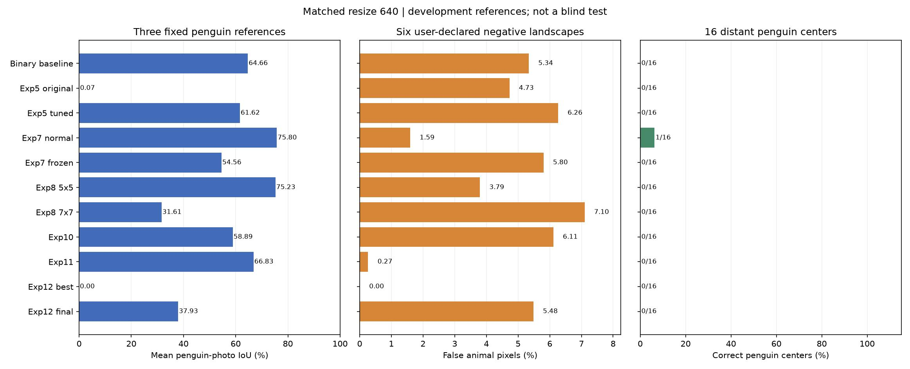

# Experiment reports

Thirteen experiment entries now have concise English reports. Experiments 1-4 are retrospective inference replays using the surviving binary checkpoint. Experiments 5 and 7-12 use preserved trained weights. Experiment 6 is a historical resource test; experiment 13 has not run. No training was performed.

| Experiment | Purpose | Result | Status | Report |
|---|---|---|---|---|
| 1 | Sliding windows and image resize | Tiles / stretch resize mean photo IoU: 47.99% / 69.23% | completed | [Read](exp01/README.md) |
| 2 | Single probability fusion | Alpha .6 mean photo IoU: 72.53% | completed | [Read](exp02/README.md) |
| 3 | Union of two biased fusions | Dual union mean photo IoU: 82.66%; landscape FP: 5.72% | completed | [Read](exp03/README.md) |
| 4 | Original-resolution direct inference | Native mean photo IoU: 55.25% | completed | [Read](exp04/README.md) |
| 5 | Five-class baseline and tuned configuration | Original / tuned historical animal mIoU: 14.60% / 78.39% | completed | [Read](exp05/README.md) |
| 6 | Batch size and throughput | Selected batch 6; 36.92 images/s; 2.72 GiB peak allocated (historical) | historical_resource_test | [Read](exp06/README.md) |
| 7 | BatchNorm policy comparison | Normal / frozen historical animal mIoU: 83.56% / 82.79% | completed | [Read](exp07/README.md) |
| 8 | Larger convolution kernels | 3x3 / 5x5 / 7x7 historical animal mIoU: 83.56% / 84.62% / 79.90% | completed | [Read](exp08/README.md) |
| 9 | Native/resize foreground union | Foreground union retains false positives from either branch; see matched method table | completed | [Read](exp09/README.md) |
| 10 | Explicit background supervision | Baseline / background historical animal mIoU: 84.62% / 83.28% | completed | [Read](exp10/README.md) |
| 11 | Penguin-weighted replay | Historical animal mIoU: 86.94%; native/resize/union photo errors measured separately | completed | [Read](exp11/README.md) |
| 12 | Sequential training without replay | Best / final historical animal mIoU: 30.44% / 6.89% | completed | [Read](exp12/README.md) |
| 13 | Alternative sequential schedule | Not run; no measured result | not_run | [Read](exp13/README.md) |

Matched cross-model protocol: 640 letterbox resize, restored logits, original-resolution scoring.

| Protocol | Mean photo IoU (3) | Pooled penguin IoU | Penguin precision | Penguin recall | Wrong animal class | Landscape FP (6) | Far penguin centers |
|---|---|---|---|---|---|---|---|
| Binary baseline | 64.66% | 73.92% | 97.53% | 75.33% | 0.00% | 5.34% | 0/16 |
| Exp5 original | 0.07% | 0.05% | 100.00% | 0.05% | 51.44% | 4.73% | 0/16 |
| Exp5 tuned | 61.62% | 68.82% | 97.65% | 69.98% | 4.87% | 6.26% | 0/16 |
| Exp7 normal | 75.80% | 81.89% | 96.88% | 84.11% | 0.00% | 1.59% | 1/16 |
| Exp7 frozen | 54.56% | 66.45% | 99.68% | 66.59% | 0.00% | 5.80% | 0/16 |
| Exp8 5x5 | 75.23% | 81.50% | 97.17% | 83.48% | 0.00% | 3.79% | 0/16 |
| Exp8 7x7 | 31.61% | 40.39% | 99.61% | 40.45% | 18.46% | 7.10% | 0/16 |
| Exp10 | 58.89% | 69.86% | 98.56% | 70.58% | 0.00% | 6.11% | 0/16 |
| Exp11 | 66.83% | 75.80% | 99.59% | 76.04% | 0.00% | 0.27% | 0/16 |
| Exp12 best | 0.00% | 0.00% | N/A | 0.00% | 0.00% | 0.00% | 0/16 |
| Exp12 final | 37.93% | 53.52% | 99.90% | 53.55% | 0.69% | 5.48% | 0/16 |

The chart and table use the same resize protocol for every model. Direct/resize/union comparisons are in the individual reports.

Fixed development references: three penguin photos and six full-background landscapes. The colony uses the user-edited mask; far uses the approved bands and near uses experiment-11 resize. These masks are diagnostic references, not an independent blind test. No positive other-bird, seal, or whale labels are present. Reported new photo scores are separate from historical 1,915-image animal validation. Standard letterbox resize uses CUDA AMP; legacy binary tile/stretch paths use float32. Native inference has a recorded float32 CPU fallback after GPU OOM. Historical models predate Wildlife source-group deduplication; no retraining was performed.

[Reference definitions](references/benchmark.md) | [All image and pooled metrics](metrics.csv) | [Per-class pixel counts](class_metrics.csv)
