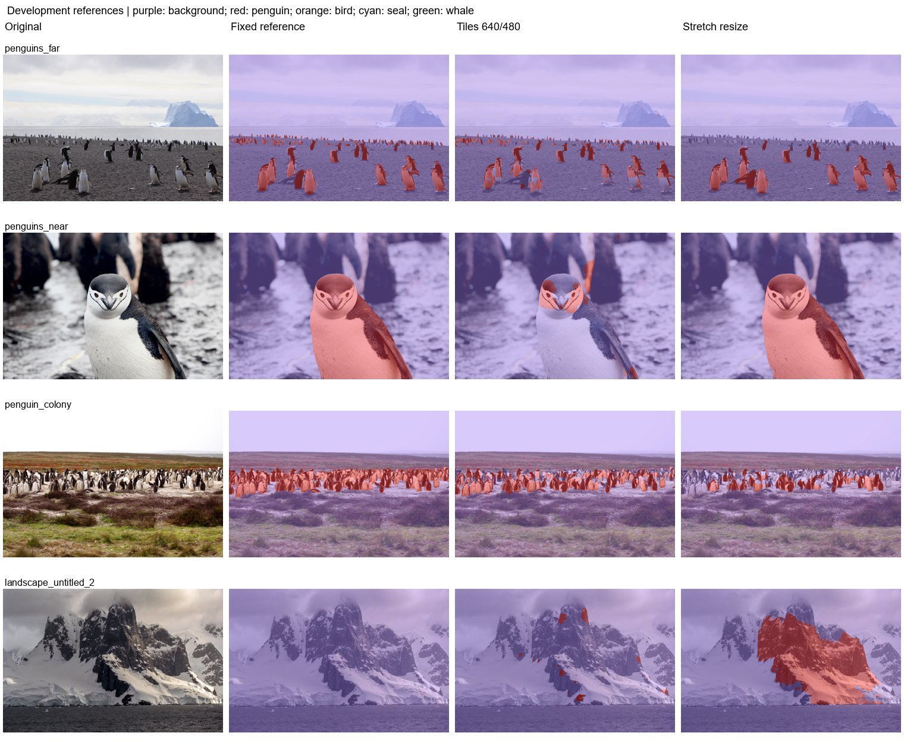

# Experiment 1: Sliding windows and image resize

Compare local high-resolution detail with whole-image context for binary penguin segmentation.

Retrospective replay uses the surviving epoch-9 binary checkpoint. Tiles are 640 pixels with stride 480; overlapping logits are averaged. The historical resize path stretches the input to 640x640 and restores logits before classification. Original screenshots may have used an earlier overwritten best checkpoint.

| Protocol | Mean photo IoU (3) | Pooled penguin IoU | Penguin precision | Penguin recall | Wrong animal class | Landscape FP (6) | Far penguin centers |
|---|---|---|---|---|---|---|---|
| Tiles 640/480 | 47.99% | 38.38% | 90.61% | 39.97% | 0.00% | 0.33% | 9/16 |
| Stretch resize 640 | 69.23% | 77.14% | 97.30% | 78.83% | 0.00% | 5.80% | 0/16 |

| Protocol | Photo | Penguin IoU | Penguin recall | Background FP |
|---|---|---|---|---|
| Tiles 640/480 | penguins_far | 60.96% | 66.56% | 0.78% |
| Tiles 640/480 | penguins_near | 12.01% | 12.39% | 0.91% |
| Tiles 640/480 | penguin_colony | 71.02% | 71.81% | 0.16% |
| Stretch resize 640 | penguins_far | 71.27% | 76.88% | 0.67% |
| Stretch resize 640 | penguins_near | 98.94% | 99.16% | 0.07% |
| Stretch resize 640 | penguin_colony | 37.49% | 37.74% | 0.09% |

The per-photo rows quantify the near/far tradeoff. Background errors on negative landscapes are reported separately from penguin recall. Among the listed protocols on this set, Stretch resize 640 has the highest mean photo IoU (69.23%); Tiles 640/480 has the lowest landscape FP (0.33%).

Historical binary/five-class replay protocol (experiments 1-12). Fixed development references: three penguin photos and six full-background landscapes. The colony uses the user-edited mask; far uses the approved bands and near uses experiment-11 resize. These masks are diagnostic references, not an independent blind test. No positive other-bird, seal, or whale labels are present. Reported new photo scores are separate from historical 1,915-image animal validation. Standard letterbox resize uses CUDA AMP; legacy binary tile/stretch paths use float32. Native inference has a recorded float32 CPU fallback after GPU OOM. Historical models predate Wildlife source-group deduplication; no retraining was performed.

Mean photo IoU averages the three penguin photos equally. Pooled IoU/precision/recall pool pixel counts on those photos. Landscape FP is all predicted animal pixels / all pixels of the six negative landscapes. Wrong animal class is true penguin pixels assigned bird/seal/whale / all true penguin pixels. Undefined metrics are N/A.

[Reference-set protocol](../references/benchmark.md) | [All experiment reports](../README.md)
