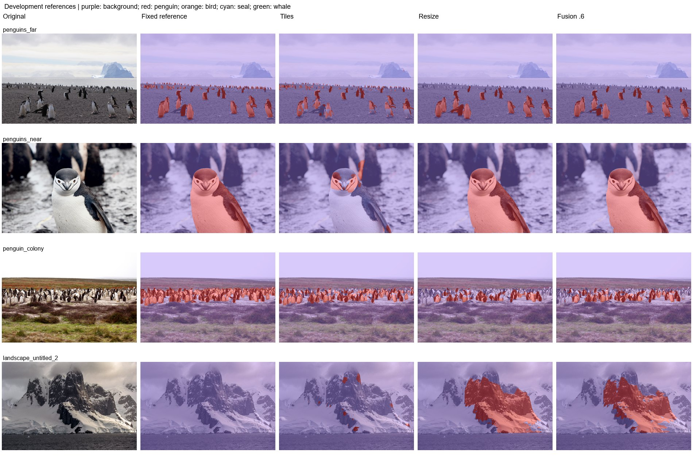

# Experiment 2: Single probability fusion

Test whether averaging tile and whole-image scores balances detail and context.

Replay uses the same binary checkpoint and branch predictions as experiment 1. The preserved notebook parameter is alpha=0.6 for whole-image resize and 0.4 for tiles; the final threshold is strictly greater than 0.5.

| Protocol | Mean photo IoU (3) | Pooled penguin IoU | Penguin precision | Penguin recall | Wrong animal class | Landscape FP (6) | Far penguin centers |
|---|---|---|---|---|---|---|---|
| Fusion alpha .6 | 72.53% | 79.23% | 97.94% | 80.58% | 0.00% | 4.77% | 0/16 |
| Tiles | 47.99% | 38.38% | 90.61% | 39.97% | 0.00% | 0.33% | 9/16 |
| Stretch resize | 69.23% | 77.14% | 97.30% | 78.83% | 0.00% | 5.80% | 0/16 |

| Protocol | Photo | Penguin IoU | Penguin recall | Background FP |
|---|---|---|---|---|
| Fusion alpha .6 | penguins_far | 70.13% | 74.70% | 0.55% |
| Fusion alpha .6 | penguins_near | 97.83% | 97.89% | 0.02% |
| Fusion alpha .6 | penguin_colony | 49.63% | 49.80% | 0.05% |
| Tiles | penguins_far | 60.96% | 66.56% | 0.78% |
| Tiles | penguins_near | 12.01% | 12.39% | 0.91% |
| Tiles | penguin_colony | 71.02% | 71.81% | 0.16% |
| Stretch resize | penguins_far | 71.27% | 76.88% | 0.67% |
| Stretch resize | penguins_near | 98.94% | 99.16% | 0.07% |
| Stretch resize | penguin_colony | 37.49% | 37.74% | 0.09% |

Averaging can suppress a weak branch response; it does not guarantee the union of detections. These are uncalibrated model scores. Among the listed protocols on this set, Fusion alpha .6 has the highest mean photo IoU (72.53%); Tiles has the lowest landscape FP (0.33%).

Historical binary/five-class replay protocol (experiments 1-12). Fixed development references: three penguin photos and six full-background landscapes. The colony uses the user-edited mask; far uses the approved bands and near uses experiment-11 resize. These masks are diagnostic references, not an independent blind test. No positive other-bird, seal, or whale labels are present. Reported new photo scores are separate from historical 1,915-image animal validation. Standard letterbox resize uses CUDA AMP; legacy binary tile/stretch paths use float32. Native inference has a recorded float32 CPU fallback after GPU OOM. Historical models predate Wildlife source-group deduplication; no retraining was performed.

Mean photo IoU averages the three penguin photos equally. Pooled IoU/precision/recall pool pixel counts on those photos. Landscape FP is all predicted animal pixels / all pixels of the six negative landscapes. Wrong animal class is true penguin pixels assigned bird/seal/whale / all true penguin pixels. Undefined metrics are N/A.

[Reference-set protocol](../references/benchmark.md) | [All experiment reports](../README.md)
