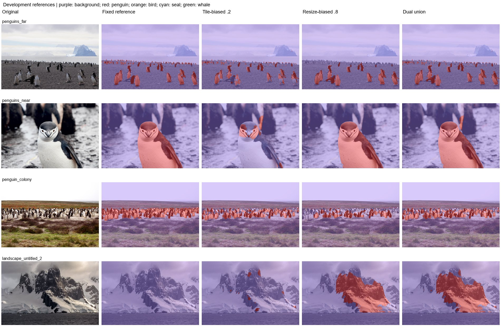

# Experiment 3: Union of two biased fusions

Preserve detections favored by either a local or global weighted fusion.

The preserved notebook used resize weights 0.2 and 0.8, not the module defaults 0.25 and 0.75. Each weighted map is thresholded at >0.5; their binary masks are unioned.

| Protocol | Mean photo IoU (3) | Pooled penguin IoU | Penguin precision | Penguin recall | Wrong animal class | Landscape FP (6) | Far penguin centers |
|---|---|---|---|---|---|---|---|
| Dual union .2/.8 | 82.66% | 86.14% | 94.87% | 90.35% | 0.00% | 5.72% | 8/16 |
| Tile-biased .2 | 48.52% | 38.97% | 91.26% | 40.48% | 0.00% | 0.32% | 8/16 |
| Resize-biased .8 | 70.68% | 78.14% | 97.68% | 79.62% | 0.00% | 5.52% | 0/16 |

| Protocol | Photo | Penguin IoU | Penguin recall | Background FP |
|---|---|---|---|---|
| Dual union .2/.8 | penguins_far | 79.24% | 89.02% | 1.05% |
| Dual union .2/.8 | penguins_near | 95.81% | 98.80% | 0.89% |
| Dual union .2/.8 | penguin_colony | 72.93% | 73.81% | 0.17% |
| Tile-biased .2 | penguins_far | 62.70% | 68.08% | 0.73% |
| Tile-biased .2 | penguins_near | 12.78% | 13.17% | 0.87% |
| Tile-biased .2 | penguin_colony | 70.07% | 70.75% | 0.14% |
| Resize-biased .8 | penguins_far | 71.44% | 76.56% | 0.61% |
| Resize-biased .8 | penguins_near | 98.66% | 98.78% | 0.04% |
| Resize-biased .8 | penguin_colony | 41.95% | 42.11% | 0.05% |

The union retains the foreground accepted by either fusion and also retains its false positives. The reference-set table measures both consequences. Among the listed protocols on this set, Dual union .2/.8 has the highest mean photo IoU (82.66%); Tile-biased .2 has the lowest landscape FP (0.32%).

Fixed development references: three penguin photos and six full-background landscapes. The colony uses the user-edited mask; far uses the approved bands and near uses experiment-11 resize. These masks are diagnostic references, not an independent blind test. No positive other-bird, seal, or whale labels are present. Reported new photo scores are separate from historical 1,915-image animal validation. Standard letterbox resize uses CUDA AMP; legacy binary tile/stretch paths use float32. Native inference has a recorded float32 CPU fallback after GPU OOM. Historical models predate Wildlife source-group deduplication; no retraining was performed.

Mean photo IoU averages the three penguin photos equally. Pooled IoU/precision/recall pool pixel counts on those photos. Landscape FP is all predicted animal pixels / all pixels of the six negative landscapes. Wrong animal class is true penguin pixels assigned bird/seal/whale / all true penguin pixels. Undefined metrics are N/A.

[Reference-set protocol](../references/benchmark.md) | [All experiment reports](../README.md)
