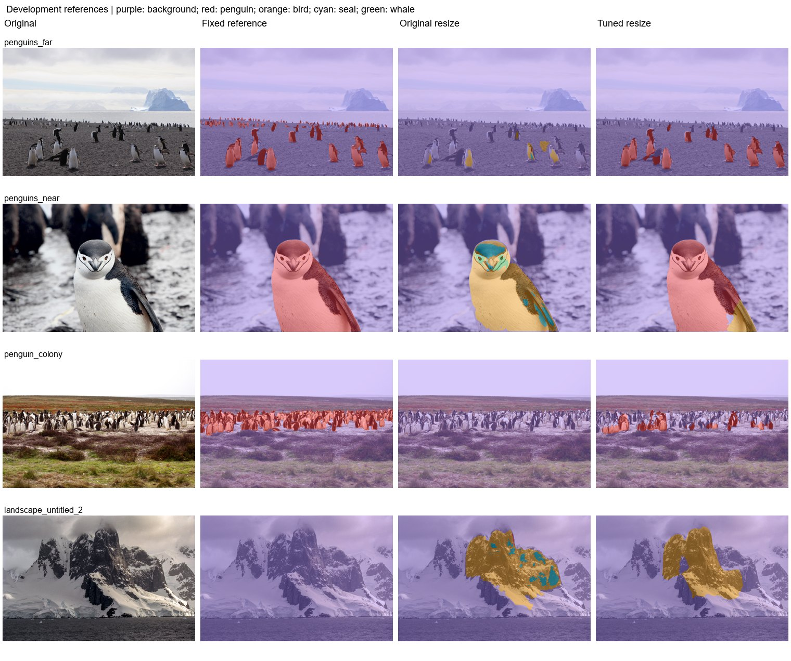

# Experiment 5: Five-class baseline and tuned configuration

Extend binary penguin segmentation to background, penguin, other bird, seal, and whale.

Compare the surviving original multiclass best checkpoint with the three-epoch tuned run (batch 4, frozen BN statistics, AMP). Both are evaluated with identical 640 letterbox-resize inference. Several settings and training budgets changed together.

| Protocol | Mean photo IoU (3) | Pooled penguin IoU | Penguin precision | Penguin recall | Wrong animal class | Landscape FP (6) | Far penguin centers |
|---|---|---|---|---|---|---|---|
| Original | 0.07% | 0.05% | 100.00% | 0.05% | 51.44% | 4.73% | 0/16 |
| Tuned | 61.62% | 68.82% | 97.65% | 69.98% | 4.87% | 6.26% | 0/16 |

| Protocol | Photo | Penguin IoU | Penguin recall | Background FP |
|---|---|---|---|---|
| Original | penguins_far | 0.18% | 0.18% | 0.30% |
| Original | penguins_near | 0.01% | 0.01% | 0.00% |
| Original | penguin_colony | 0.00% | 0.00% | 0.00% |
| Tuned | penguins_far | 68.78% | 72.33% | 0.44% |
| Tuned | penguins_near | 88.61% | 88.80% | 0.11% |
| Tuned | penguin_colony | 27.45% | 27.82% | 0.19% |

Historical labeled-validation results:

| Checkpoint | Selected epoch | Epoch budget | Batch | BN policy | Kernel | Animal mIoU | Penguin IoU | Bird IoU | Seal IoU | Whale IoU |
|---|---|---|---|---|---|---|---|---|---|---|
| Original | 6 | unrecorded | unrecorded | unrecorded | 3 | 14.60% | 0.33% | 37.56% | 20.49% | 0.00% |
| Tuned | 3 | 3 | 4 | frozen_stats | 3 | 78.39% | 81.75% | 82.18% | 88.29% | 61.34% |

Historical validation improves substantially with the combined tuned configuration. This comparison cannot isolate batch size as the sole cause. The development references measure penguin/background transfer, not positive bird/seal/whale recall. Among the listed protocols on this set, Tuned has the highest mean photo IoU (61.62%); Original has the lowest landscape FP (4.73%).

Historical binary/five-class replay protocol (experiments 1-12). Fixed development references: three penguin photos and six full-background landscapes. The colony uses the user-edited mask; far uses the approved bands and near uses experiment-11 resize. These masks are diagnostic references, not an independent blind test. No positive other-bird, seal, or whale labels are present. Reported new photo scores are separate from historical 1,915-image animal validation. Standard letterbox resize uses CUDA AMP; legacy binary tile/stretch paths use float32. Native inference has a recorded float32 CPU fallback after GPU OOM. Historical models predate Wildlife source-group deduplication; no retraining was performed.

Mean photo IoU averages the three penguin photos equally. Pooled IoU/precision/recall pool pixel counts on those photos. Landscape FP is all predicted animal pixels / all pixels of the six negative landscapes. Wrong animal class is true penguin pixels assigned bird/seal/whale / all true penguin pixels. Undefined metrics are N/A.

[Reference-set protocol](../references/benchmark.md) | [All experiment reports](../README.md)
