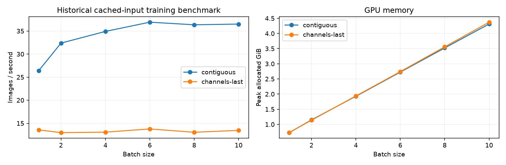

# Experiment 6: batch size and throughput

Select a practical GPU batch size before accuracy experiments. The historical benchmark uses cached inputs, AMP, real backward/AdamW steps, and an 80% GPU-memory cap; it excludes image loading and decoding. No accuracy checkpoint or ten-epoch run is defined for this resource test.

| Batch | Channels-last | Status | Images/s | Peak allocated GiB |
|---|---|---|---|---|
| 1 | False | ok | 26.41 | 0.73 |
| 2 | False | ok | 32.38 | 1.15 |
| 4 | False | ok | 34.91 | 1.93 |
| 6 | False | ok | 36.92 | 2.72 |
| 8 | False | ok | 36.35 | 3.52 |
| 10 | False | ok | 36.50 | 4.31 |
| 1 | True | ok | 13.56 | 0.73 |
| 2 | True | ok | 12.97 | 1.14 |
| 4 | True | ok | 13.08 | 1.94 |
| 6 | True | ok | 13.77 | 2.74 |
| 8 | True | ok | 13.05 | 3.56 |
| 10 | True | ok | 13.46 | 4.37 |

Selected batch: **6**, contiguous layout, **36.92 images/s**, **2.72 GiB** peak allocated. This was the smallest batch within 95% of measured maximum throughput; it is not a universal optimal batch size.

[All experiment reports](../README.md)
