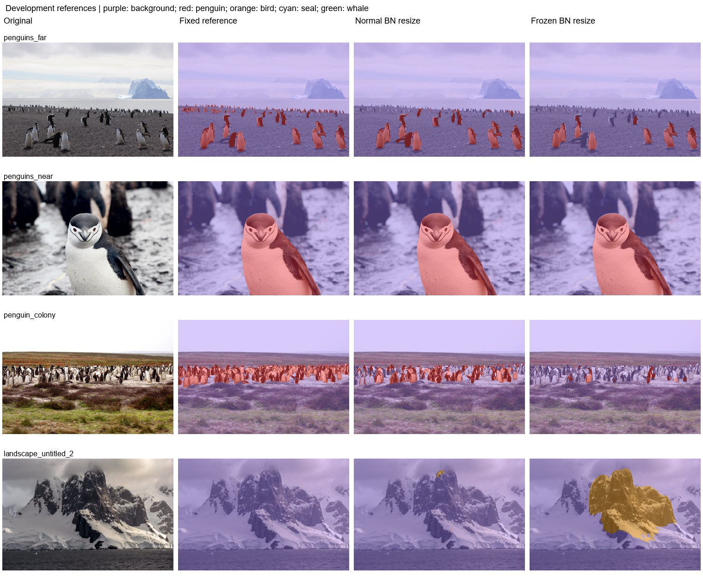

# Experiment 7: BatchNorm policy comparison

Compare updating BN running statistics with freezing them during multiclass training.

The recorded controlled runs use the same binary initialization, batch 6, seed 42, and ten-epoch budget. Compare each policy's best checkpoint using the same fixed-reference inference protocol.

| Protocol | Mean photo IoU (3) | Pooled penguin IoU | Penguin precision | Penguin recall | Wrong animal class | Landscape FP (6) | Far penguin centers |
|---|---|---|---|---|---|---|---|
| Normal BN | 75.80% | 81.89% | 96.88% | 84.11% | 0.00% | 1.59% | 1/16 |
| Frozen statistics | 54.56% | 66.45% | 99.68% | 66.59% | 0.00% | 5.80% | 0/16 |

| Protocol | Photo | Penguin IoU | Penguin recall | Background FP |
|---|---|---|---|---|
| Normal BN | penguins_far | 73.74% | 79.06% | 0.61% |
| Normal BN | penguins_near | 99.49% | 99.81% | 0.09% |
| Normal BN | penguin_colony | 54.15% | 55.92% | 0.47% |
| Frozen statistics | penguins_far | 57.45% | 57.90% | 0.07% |
| Frozen statistics | penguins_near | 98.43% | 98.47% | 0.01% |
| Frozen statistics | penguin_colony | 7.79% | 7.79% | 0.00% |

Historical labeled-validation results:

| Checkpoint | Selected epoch | Epoch budget | Batch | BN policy | Kernel | Animal mIoU | Penguin IoU | Bird IoU | Seal IoU | Whale IoU |
|---|---|---|---|---|---|---|---|---|---|---|
| Normal BN | 8 | 10 | 6 | normal | 3 | 83.56% | 87.39% | 87.55% | 93.66% | 65.65% |
| Frozen statistics | 4 | 10 | 6 | frozen_stats | 3 | 82.79% | 85.45% | 84.49% | 92.28% | 68.96% |

Normal BN has the higher historical full-animal validation mIoU. The new photo results test whether that ordering transfers to these high-resolution scenes. Among the listed protocols on this set, Normal BN has the highest mean photo IoU (75.80%); Normal BN has the lowest landscape FP (1.59%).

Historical binary/five-class replay protocol (experiments 1-12). Fixed development references: three penguin photos and six full-background landscapes. The colony uses the user-edited mask; far uses the approved bands and near uses experiment-11 resize. These masks are diagnostic references, not an independent blind test. No positive other-bird, seal, or whale labels are present. Reported new photo scores are separate from historical 1,915-image animal validation. Standard letterbox resize uses CUDA AMP; legacy binary tile/stretch paths use float32. Native inference has a recorded float32 CPU fallback after GPU OOM. Historical models predate Wildlife source-group deduplication; no retraining was performed.

Mean photo IoU averages the three penguin photos equally. Pooled IoU/precision/recall pool pixel counts on those photos. Landscape FP is all predicted animal pixels / all pixels of the six negative landscapes. Wrong animal class is true penguin pixels assigned bird/seal/whale / all true penguin pixels. Undefined metrics are N/A.

[Reference-set protocol](../references/benchmark.md) | [All experiment reports](../README.md)
