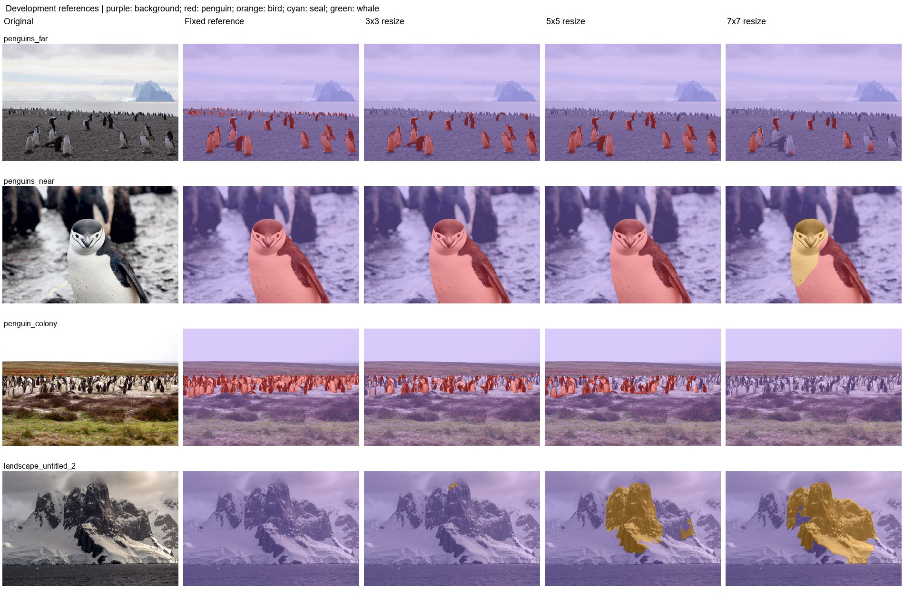

# Experiment 8: Larger convolution kernels

Test 5x5 and 7x7 convolutions against the 3x3 baseline.

Use completed ten-epoch runs with the recorded feasible batch sizes. Encoder/decoder 3x3 convolutions were enlarged; the stem and 1x1 layers stayed unchanged. Initial weights were center-copied with zero rings. Compare best checkpoints under identical resize inference.

| Protocol | Mean photo IoU (3) | Pooled penguin IoU | Penguin precision | Penguin recall | Wrong animal class | Landscape FP (6) | Far penguin centers |
|---|---|---|---|---|---|---|---|
| 3x3 | 75.80% | 81.89% | 96.88% | 84.11% | 0.00% | 1.59% | 1/16 |
| 5x5 | 75.23% | 81.50% | 97.17% | 83.48% | 0.00% | 3.79% | 0/16 |
| 7x7 | 31.61% | 40.39% | 99.61% | 40.45% | 18.46% | 7.10% | 0/16 |

| Protocol | Photo | Penguin IoU | Penguin recall | Background FP |
|---|---|---|---|---|
| 3x3 | penguins_far | 73.74% | 79.06% | 0.61% |
| 3x3 | penguins_near | 99.49% | 99.81% | 0.09% |
| 3x3 | penguin_colony | 54.15% | 55.92% | 0.47% |
| 5x5 | penguins_far | 76.83% | 80.84% | 0.44% |
| 5x5 | penguins_near | 99.73% | 99.96% | 0.07% |
| 5x5 | penguin_colony | 49.14% | 51.24% | 0.61% |
| 7x7 | penguins_far | 30.93% | 31.01% | 0.02% |
| 7x7 | penguins_near | 63.91% | 64.02% | 0.22% |
| 7x7 | penguin_colony | 0.00% | 0.00% | 0.00% |

Historical labeled-validation results:

| Checkpoint | Selected epoch | Epoch budget | Batch | BN policy | Kernel | Animal mIoU | Penguin IoU | Bird IoU | Seal IoU | Whale IoU |
|---|---|---|---|---|---|---|---|---|---|---|
| 3x3 | 8 | 10 | 6 | normal | 3 | 83.56% | 87.39% | 87.55% | 93.66% | 65.65% |
| 5x5 | 8 | 10 | 6 | normal | 5 | 84.62% | 87.69% | 86.66% | 91.38% | 72.75% |
| 7x7 | 9 | 10 | 6 | normal | 7 | 79.90% | 87.18% | 85.35% | 90.60% | 56.48% |

| Kernel | Parameters | Deepest theoretical receptive field |
|---|---|---|
| 3 | 24,495,237 | 899 |
| 5 | 67,683,461 | 1787 |
| 7 | 132,465,797 | 2675 |

The first combined resource/pilot attempt was interrupted after the 3x3 pilot and part of the 5x5 pilot, before full larger-kernel training. The requested 5x5 model was then trained separately on November 9; the 7x7 continuation was completed on November 10. Pilot results are not counted as completed ten-epoch runs.

Historical animal mIoU is 83.56%, 84.62%, and 79.90% for 3x3, 5x5, and 7x7. Larger kernels do not produce a monotonic improvement. All three completed comparisons use batch 6. Enlarging kernels also increases parameter count and changes optimization, so the results do not isolate receptive field as the cause of errors. Among the listed protocols on this set, 3x3 has the highest mean photo IoU (75.80%); 3x3 has the lowest landscape FP (1.59%).

Fixed development references: three penguin photos and six full-background landscapes. The colony uses the user-edited mask; far uses the approved bands and near uses experiment-11 resize. These masks are diagnostic references, not an independent blind test. No positive other-bird, seal, or whale labels are present. Reported new photo scores are separate from historical 1,915-image animal validation. Standard letterbox resize uses CUDA AMP; legacy binary tile/stretch paths use float32. Native inference has a recorded float32 CPU fallback after GPU OOM. Historical models predate Wildlife source-group deduplication; no retraining was performed.

Mean photo IoU averages the three penguin photos equally. Pooled IoU/precision/recall pool pixel counts on those photos. Landscape FP is all predicted animal pixels / all pixels of the six negative landscapes. Wrong animal class is true penguin pixels assigned bird/seal/whale / all true penguin pixels. Undefined metrics are N/A.

[Reference-set protocol](../references/benchmark.md) | [All experiment reports](../README.md)
