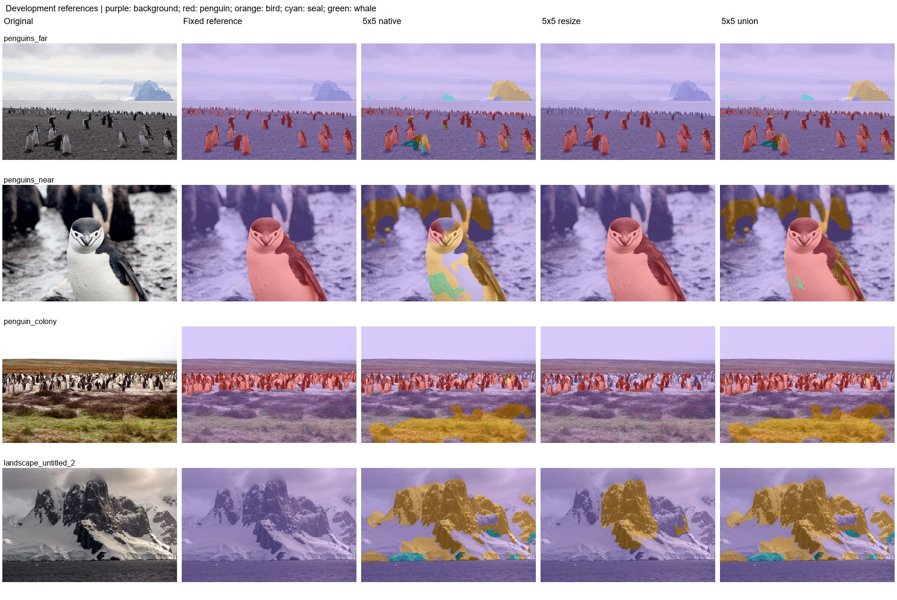

# Experiment 9: Native/resize foreground union

Measure the recall and false-positive effects of combining native and resized five-class predictions.

For each 3x3/5x5/7x7 checkpoint, infer both original resolution and 640 letterbox resize. Keep foreground from either branch; resolve conflicting animal classes using the branch's selected-class score. No model is trained in this experiment. The figure shows the 5x5 run; the table includes all three kernels.

| Protocol | Mean photo IoU (3) | Pooled penguin IoU | Penguin precision | Penguin recall | Wrong animal class | Landscape FP (6) | Far penguin centers |
|---|---|---|---|---|---|---|---|
| 3x3 native | 47.03% | 38.96% | 90.73% | 40.57% | 48.20% | 15.16% | 11/16 |
| 3x3 resize | 75.80% | 81.89% | 96.88% | 84.11% | 0.00% | 1.59% | 1/16 |
| 3x3 union | 75.49% | 75.75% | 93.21% | 80.18% | 14.82% | 15.85% | 11/16 |
| 5x5 native | 47.45% | 37.08% | 92.59% | 38.21% | 40.48% | 14.98% | 13/16 |
| 5x5 resize | 75.23% | 81.50% | 97.17% | 83.48% | 0.00% | 3.79% | 0/16 |
| 5x5 union | 81.76% | 83.39% | 94.83% | 87.36% | 8.11% | 15.20% | 13/16 |
| 7x7 native | 19.74% | 16.11% | 96.85% | 16.19% | 55.79% | 70.49% | 2/16 |
| 7x7 resize | 31.61% | 40.39% | 99.61% | 40.45% | 18.46% | 7.10% | 0/16 |
| 7x7 union | 29.84% | 27.89% | 97.90% | 28.06% | 49.48% | 70.74% | 2/16 |

| Protocol | Photo | Penguin IoU | Penguin recall | Background FP |
|---|---|---|---|---|
| 3x3 native | penguins_far | 59.58% | 67.17% | 46.49% |
| 3x3 native | penguins_near | 15.44% | 15.69% | 56.72% |
| 3x3 native | penguin_colony | 66.08% | 66.71% | 42.50% |
| 3x3 resize | penguins_far | 73.74% | 79.06% | 0.61% |
| 3x3 resize | penguins_near | 99.49% | 99.81% | 0.09% |
| 3x3 resize | penguin_colony | 54.15% | 55.92% | 0.47% |
| 3x3 union | penguins_far | 76.63% | 89.44% | 46.78% |
| 3x3 union | penguins_near | 76.36% | 77.67% | 56.75% |
| 3x3 union | penguin_colony | 73.49% | 76.23% | 42.90% |
| 5x5 native | penguins_far | 64.98% | 72.32% | 5.18% |
| 5x5 native | penguins_near | 6.13% | 6.13% | 14.99% |
| 5x5 native | penguin_colony | 71.23% | 72.08% | 22.99% |
| 5x5 resize | penguins_far | 76.83% | 80.84% | 0.44% |
| 5x5 resize | penguins_near | 99.73% | 99.96% | 0.07% |
| 5x5 resize | penguin_colony | 49.14% | 51.24% | 0.61% |
| 5x5 union | penguins_far | 80.12% | 91.52% | 5.42% |
| 5x5 union | penguins_near | 88.46% | 88.60% | 15.02% |
| 5x5 union | penguin_colony | 76.69% | 80.58% | 23.54% |
| 7x7 native | penguins_far | 29.29% | 29.88% | 61.68% |
| 7x7 native | penguins_near | 6.16% | 6.16% | 74.63% |
| 7x7 native | penguin_colony | 23.76% | 23.78% | 74.79% |
| 7x7 resize | penguins_far | 30.93% | 31.01% | 0.02% |
| 7x7 resize | penguins_near | 63.91% | 64.02% | 0.22% |
| 7x7 resize | penguin_colony | 0.00% | 0.00% | 0.00% |
| 7x7 union | penguins_far | 43.35% | 44.32% | 61.70% |
| 7x7 union | penguins_near | 22.41% | 22.42% | 74.73% |
| 7x7 union | penguin_colony | 23.76% | 23.78% | 74.79% |

A foreground union cannot remove a foreground false positive already present in either branch. Class-conflict resolution may also change strict penguin accuracy. Use the table to judge recall against background error. Among the listed protocols on this set, 5x5 union has the highest mean photo IoU (81.76%); 3x3 resize has the lowest landscape FP (1.59%).

Historical binary/five-class replay protocol (experiments 1-12). Fixed development references: three penguin photos and six full-background landscapes. The colony uses the user-edited mask; far uses the approved bands and near uses experiment-11 resize. These masks are diagnostic references, not an independent blind test. No positive other-bird, seal, or whale labels are present. Reported new photo scores are separate from historical 1,915-image animal validation. Standard letterbox resize uses CUDA AMP; legacy binary tile/stretch paths use float32. Native inference has a recorded float32 CPU fallback after GPU OOM. Historical models predate Wildlife source-group deduplication; no retraining was performed.

Mean photo IoU averages the three penguin photos equally. Pooled IoU/precision/recall pool pixel counts on those photos. Landscape FP is all predicted animal pixels / all pixels of the six negative landscapes. Wrong animal class is true penguin pixels assigned bird/seal/whale / all true penguin pixels. Undefined metrics are N/A.

[Reference-set protocol](../references/benchmark.md) | [All experiment reports](../README.md)
