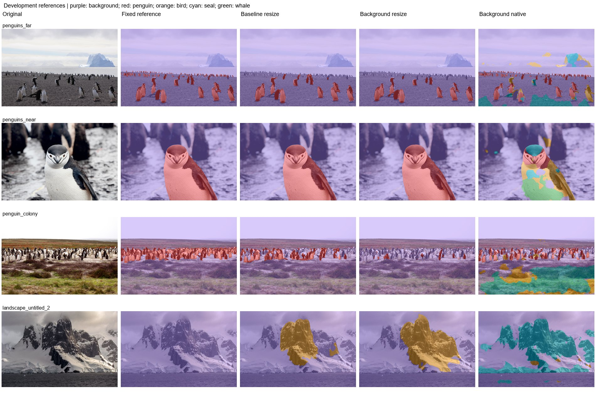

# Experiment 10: Explicit background supervision

Test whether adding natural-background examples suppresses animal false positives.

Compare the experiment-8 5x5 baseline with the completed ten-epoch background-supervised run. The recorded sampler gives equal probability mass to background and each of the four animal groups. Use identical reference photos and inference protocols.

| Protocol | Mean photo IoU (3) | Pooled penguin IoU | Penguin precision | Penguin recall | Wrong animal class | Landscape FP (6) | Far penguin centers |
|---|---|---|---|---|---|---|---|
| Baseline resize | 75.23% | 81.50% | 97.17% | 83.48% | 0.00% | 3.79% | 0/16 |
| Background resize | 58.89% | 69.86% | 98.56% | 70.58% | 0.00% | 6.11% | 0/16 |
| Background native | 39.32% | 33.43% | 94.25% | 34.12% | 45.70% | 15.46% | 15/16 |
| Background union | 67.44% | 69.49% | 96.59% | 71.24% | 16.19% | 16.57% | 15/16 |

| Protocol | Photo | Penguin IoU | Penguin recall | Background FP |
|---|---|---|---|---|
| Baseline resize | penguins_far | 76.83% | 80.84% | 0.44% |
| Baseline resize | penguins_near | 99.73% | 99.96% | 0.07% |
| Baseline resize | penguin_colony | 49.14% | 51.24% | 0.61% |
| Background resize | penguins_far | 70.14% | 72.80% | 0.32% |
| Background resize | penguins_near | 99.22% | 99.43% | 0.06% |
| Background resize | penguin_colony | 7.30% | 7.30% | 0.00% |
| Background native | penguins_far | 55.07% | 59.50% | 10.46% |
| Background native | penguins_near | 16.09% | 16.11% | 1.36% |
| Background native | penguin_colony | 46.78% | 46.94% | 35.05% |
| Background union | penguins_far | 79.69% | 87.43% | 10.57% |
| Background union | penguins_near | 74.19% | 74.30% | 1.38% |
| Background union | penguin_colony | 48.44% | 48.61% | 35.05% |

Historical labeled-validation results:

| Checkpoint | Selected epoch | Epoch budget | Batch | BN policy | Kernel | Animal mIoU | Penguin IoU | Bird IoU | Seal IoU | Whale IoU |
|---|---|---|---|---|---|---|---|---|---|---|
| Baseline | 8 | 10 | 6 | normal | 5 | 84.62% | 87.69% | 86.66% | 91.38% | 72.75% |
| Background supervised | 10 | 10 | 6 | normal | 5 | 83.28% | 87.44% | 86.52% | 91.22% | 67.93% |

Historical full-animal mIoU fell from 84.62% to 83.28%. Background supervision is a distribution tradeoff; improvements on a natural-background holdout do not establish improvement on every Antarctic landscape. Equal sampling-group mass does not balance pixels or equalize per-image exposure. Among the listed protocols on this set, Baseline resize has the highest mean photo IoU (75.23%); Baseline resize has the lowest landscape FP (3.79%).

Historical binary/five-class replay protocol (experiments 1-12). Fixed development references: three penguin photos and six full-background landscapes. The colony uses the user-edited mask; far uses the approved bands and near uses experiment-11 resize. These masks are diagnostic references, not an independent blind test. No positive other-bird, seal, or whale labels are present. Reported new photo scores are separate from historical 1,915-image animal validation. Standard letterbox resize uses CUDA AMP; legacy binary tile/stretch paths use float32. Native inference has a recorded float32 CPU fallback after GPU OOM. Historical models predate Wildlife source-group deduplication; no retraining was performed.

Mean photo IoU averages the three penguin photos equally. Pooled IoU/precision/recall pool pixel counts on those photos. Landscape FP is all predicted animal pixels / all pixels of the six negative landscapes. Wrong animal class is true penguin pixels assigned bird/seal/whale / all true penguin pixels. Undefined metrics are N/A.

[Reference-set protocol](../references/benchmark.md) | [All experiment reports](../README.md)
