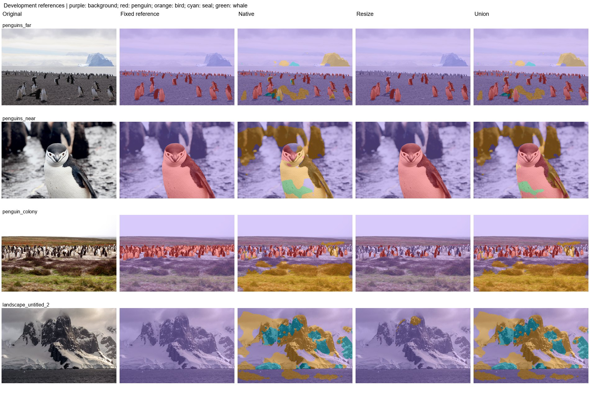

# Experiment 11: Penguin-weighted replay

Recover penguin performance while retaining explicit background and other-animal replay.

The five-epoch run starts from the full experiment-8 5x5 model. The sampler assigns penguin 50%, background 20%, and each other group 10%, with 2,000 draws per epoch. Epoch 3 is the best checkpoint. Verified saved branch masks are reused and rescored against the newly frozen full reference masks.

| Protocol | Mean photo IoU (3) | Pooled penguin IoU | Penguin precision | Penguin recall | Wrong animal class | Landscape FP (6) | Far penguin centers |
|---|---|---|---|---|---|---|---|
| Native | 42.49% | 34.19% | 94.74% | 34.85% | 49.88% | 21.59% | 13/16 |
| Resize | 66.83% | 75.80% | 99.59% | 76.04% | 0.00% | 0.27% | 0/16 |
| Union | 73.23% | 74.68% | 97.15% | 76.35% | 15.91% | 21.59% | 13/16 |

| Protocol | Photo | Penguin IoU | Penguin recall | Background FP |
|---|---|---|---|---|
| Native | penguins_far | 66.36% | 71.58% | 8.38% |
| Native | penguins_near | 9.73% | 9.73% | 24.82% |
| Native | penguin_colony | 51.39% | 51.41% | 38.14% |
| Resize | penguins_far | 80.82% | 81.65% | 0.09% |
| Resize | penguins_near | 100.00% | 100.00% | 0.00% |
| Resize | penguin_colony | 19.68% | 19.73% | 0.04% |
| Union | penguins_far | 85.64% | 93.27% | 8.47% |
| Union | penguins_near | 77.77% | 77.80% | 24.82% |
| Union | penguin_colony | 56.27% | 56.42% | 38.17% |

Historical labeled-validation results:

| Checkpoint | Selected epoch | Epoch budget | Batch | BN policy | Kernel | Animal mIoU | Penguin IoU | Bird IoU | Seal IoU | Whale IoU |
|---|---|---|---|---|---|---|---|---|---|---|
| Best epoch 3 | 3 | 5 | 6 | normal | 5 | 86.94% | 89.49% | 88.64% | 93.89% | 75.72% |

False-positive pixels by predicted class, divided by all pixels of the six landscapes:

| Protocol | Penguin FP | Other bird FP | Seal FP | Whale FP |
|---|---|---|---|---|
| Native | 0.00% | 17.90% | 3.65% | 0.05% |
| Resize | 0.00% | 0.25% | 0.02% | 0.00% |
| Union | 0.00% | 17.91% | 3.64% | 0.05% |

True penguin pixels assigned another class, divided by all true penguin pixels on the three penguin photos:

| Protocol | Penguin to bird | Penguin to seal | Penguin to whale | Penguin to background |
|---|---|---|---|---|
| Native | 41.61% | 1.00% | 7.27% | 15.26% |
| Resize | 0.00% | 0.00% | 0.00% | 23.96% |
| Union | 11.31% | 0.31% | 4.29% | 7.74% |

Historical full-animal mIoU reaches 86.94%. Far/near reference masks originate from this model, so these development scores may favor it. Near uses this checkpoint's own resize mask: its 100% IoU is a self-consistency result, not an independent accuracy estimate. The negative landscapes and manually revised colony provide additional error checks; they do not turn the set into a blind benchmark. Among the listed protocols on this set, Union has the highest mean photo IoU (73.23%); Resize has the lowest landscape FP (0.27%).

Historical binary/five-class replay protocol (experiments 1-12). Fixed development references: three penguin photos and six full-background landscapes. The colony uses the user-edited mask; far uses the approved bands and near uses experiment-11 resize. These masks are diagnostic references, not an independent blind test. No positive other-bird, seal, or whale labels are present. Reported new photo scores are separate from historical 1,915-image animal validation. Standard letterbox resize uses CUDA AMP; legacy binary tile/stretch paths use float32. Native inference has a recorded float32 CPU fallback after GPU OOM. Historical models predate Wildlife source-group deduplication; no retraining was performed.

Mean photo IoU averages the three penguin photos equally. Pooled IoU/precision/recall pool pixel counts on those photos. Landscape FP is all predicted animal pixels / all pixels of the six negative landscapes. Wrong animal class is true penguin pixels assigned bird/seal/whale / all true penguin pixels. Undefined metrics are N/A.

[Reference-set protocol](../references/benchmark.md) | [All experiment reports](../README.md)

The previous partial-ROI audit is preserved under artifacts/reference_benchmark/previous_exp11_report/. Its provisional-ROI denominators differ from this full-reference evaluation.
