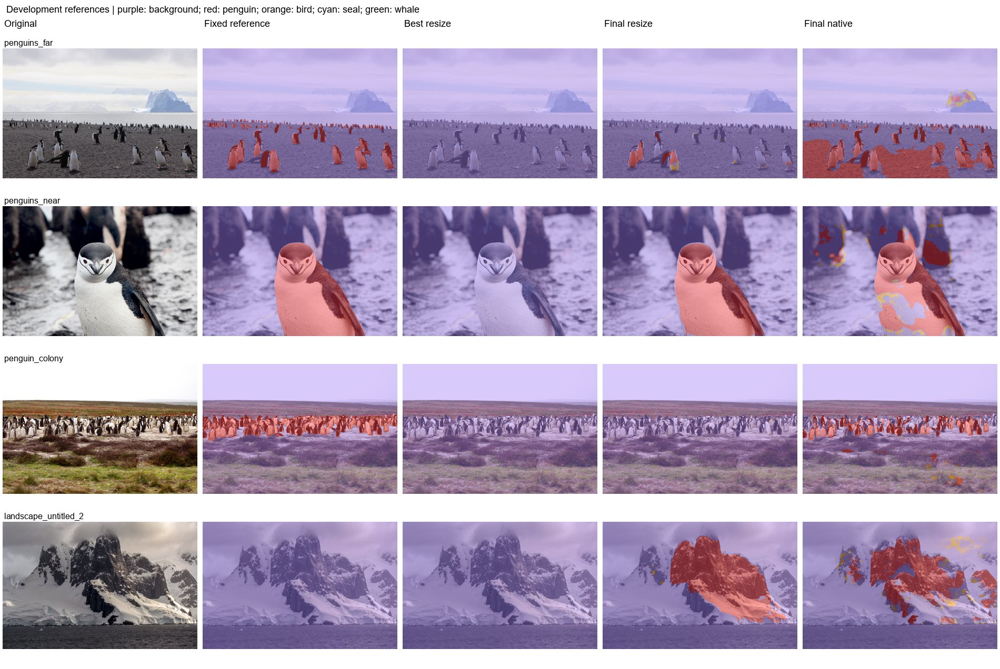

# Experiment 12: Sequential training without replay

Evaluate the requested background/wildlife, bird, whale, seal, and penguin training sequence.

The recorded schedule is 10+15+5+5+5 epochs, initialized from binary features plus a fresh five-class head. Each stage passes its last checkpoint to the next stage without replay. Evaluate the globally selected best checkpoint and the final checkpoint separately.

| Protocol | Mean photo IoU (3) | Pooled penguin IoU | Penguin precision | Penguin recall | Wrong animal class | Landscape FP (6) | Far penguin centers |
|---|---|---|---|---|---|---|---|
| Overall best resize | 0.00% | 0.00% | N/A | 0.00% | 0.00% | 0.00% | 0/16 |
| Final resize | 37.93% | 53.52% | 99.90% | 53.55% | 0.69% | 5.48% | 0/16 |
| Overall best native | 19.16% | 14.69% | 98.63% | 14.72% | 48.30% | 9.03% | 4/16 |
| Final native | 48.61% | 46.89% | 57.20% | 72.23% | 2.31% | 6.84% | 2/16 |

| Protocol | Photo | Penguin IoU | Penguin recall | Background FP |
|---|---|---|---|---|
| Overall best resize | penguins_far | 0.00% | 0.00% | 0.00% |
| Overall best resize | penguins_near | 0.00% | 0.00% | 0.00% |
| Overall best resize | penguin_colony | 0.00% | 0.00% | 0.00% |
| Final resize | penguins_far | 18.39% | 18.43% | 0.02% |
| Final resize | penguins_near | 95.40% | 95.40% | 0.00% |
| Final resize | penguin_colony | 0.00% | 0.00% | 0.00% |
| Overall best native | penguins_far | 20.13% | 20.27% | 1.36% |
| Overall best native | penguins_near | 2.65% | 2.65% | 3.05% |
| Overall best native | penguin_colony | 34.70% | 34.74% | 17.74% |
| Final native | penguins_far | 28.84% | 81.27% | 16.10% |
| Final native | penguins_near | 65.31% | 76.53% | 6.17% |
| Final native | penguin_colony | 51.69% | 54.14% | 0.98% |

Historical labeled-validation results:

| Checkpoint | Selected epoch | Epoch budget | Batch | BN policy | Kernel | Animal mIoU | Penguin IoU | Bird IoU | Seal IoU | Whale IoU |
|---|---|---|---|---|---|---|---|---|---|---|
| Overall best | 10 | 10 | 6 | normal | 5 | 30.44% | 46.80% | 49.72% | 11.50% | 13.74% |
| Final | 5 | 5 | 6 | normal | 5 | 6.89% | 15.76% | 11.67% | 0.01% | 0.12% |

| Stage | Epoch budget | Best animal mIoU | End-of-stage animal mIoU |
|---|---|---|---|
| background_wildlife | 10 | 30.44% | 30.44% |
| other_bird | 15 | 17.51% | 14.50% |
| whale | 5 | 15.27% | 9.46% |
| seal | 5 | 6.86% | 6.27% |
| penguin | 5 | 12.81% | 6.89% |

The overall selected checkpoint is from stage 1 (30.44% historical animal mIoU); the final checkpoint is 6.89%. Later sequential stages reduce performance on the combined validation set, consistent with forgetting and specialization. The final model can nevertheless score better on penguin-only development references: overall best refers to the historical multi-animal selection criterion. Displaying only the selected best would hide the final outcome. Among the listed protocols on this set, Final native has the highest mean photo IoU (48.61%); Overall best resize has the lowest landscape FP (0.00%).

Fixed development references: three penguin photos and six full-background landscapes. The colony uses the user-edited mask; far uses the approved bands and near uses experiment-11 resize. These masks are diagnostic references, not an independent blind test. No positive other-bird, seal, or whale labels are present. Reported new photo scores are separate from historical 1,915-image animal validation. Standard letterbox resize uses CUDA AMP; legacy binary tile/stretch paths use float32. Native inference has a recorded float32 CPU fallback after GPU OOM. Historical models predate Wildlife source-group deduplication; no retraining was performed.

Mean photo IoU averages the three penguin photos equally. Pooled IoU/precision/recall pool pixel counts on those photos. Landscape FP is all predicted animal pixels / all pixels of the six negative landscapes. Wrong animal class is true penguin pixels assigned bird/seal/whale / all true penguin pixels. Undefined metrics are N/A.

[Reference-set protocol](../references/benchmark.md) | [All experiment reports](../README.md)
