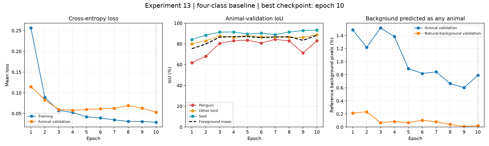
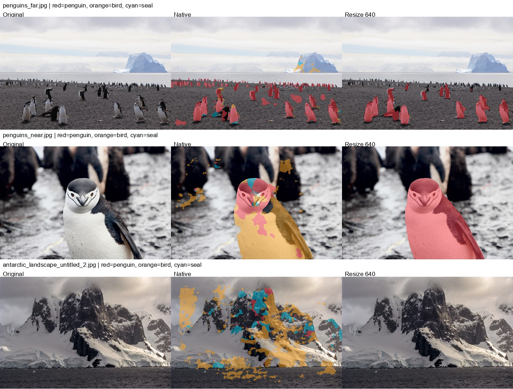

# Experiment 13: new four-class baseline

Status: training complete. Evaluation complete.

Hand-written ResNet34 U-Net, four outputs, 3x3 kernels with the original 7x7 stem. ImageNet encoder; random decoder/head. No penguin-baseline or experiment-8/11 initialization. Ten joint-training epochs; 640 letterbox input, nearest masks; AMP, normal BN; AdamW lr=1e-4, weight decay=0.01; CrossEntropy(ignore=255); seed 42; constant LR. Batch 6 changes to 4 only after an OOM. Real preflight updates are discarded.

Classes: background=0, penguin=1, other_bird=2, seal=3, ignore=255. Whale pixels map 4 to 0 on a separate dataset view; void/unknown/padding remain 255. Original data, splits, five-class globals and historical readers are preserved. Groups are recomputed from converted masks: largest target-foreground area, otherwise background. Per-image sampling weight is 1/sqrt(group size), with replacement and len(train) draws per epoch. This is an unvalidated mild resampling candidate, not pixel balancing. Actual draw counts are recorded per completed epoch.

Model selection uses the three foreground-class mean IoU on the current deduplicated animal validation set. Natural-background validation is separate. Bird/seal recall comes from this animal validation, since the development references have no positive labels for these classes.

Best epoch: 10; animal foreground mIoU: 0.8837; last epoch mIoU: 0.8837. Actual final batch size: 6.

Saved epoch logs: [CSV](metrics.csv). The plot separates training/animal-validation losses, class IoUs and background false positives. Natural-background validation is distinct from the six development landscape photographs.

Full masks, inference devices and local gallery: `E:\workspace\pyscripts\semseg\artifacts\experiments\exp13_results\run_20261111_150108`. Nine frozen benchmark_v2 references are scored with native and aspect-preserving resize inference only. The 16 far-penguin points use exact existing pixel coordinates, reporting penguin hits and any-animal hits, not instance recall. Six user-declared landscape negatives report pooled and per-animal false-positive pixel fractions. NJU photos are visualization only; no IoU is reported.

benchmark_v2 is preserved unchanged. Its masks are development references, partly model-assisted: near uses experiment-11 resize, and far has model-assisted bands. Scores are reference agreement, not an independent blind test. Historical reference predictions, when available, are rescored after mapping their whale labels to background; historical five-class validation mIoU is never compared directly with this four-class mIoU.

This is a new baseline, not an isolated whale-removal ablation: initialization, kernel, current deduplicated data and sampling also differ from historical runs. This replaces the superseded sequential experiment-13 proposal. No test data is used for training or checkpoint selection.
