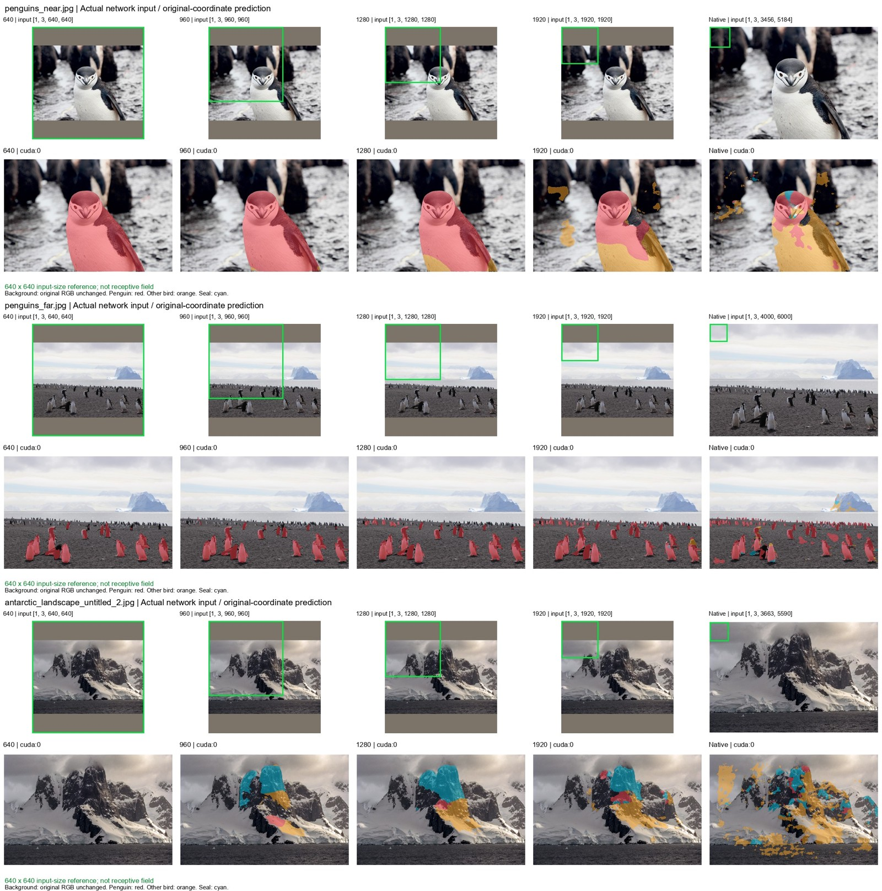
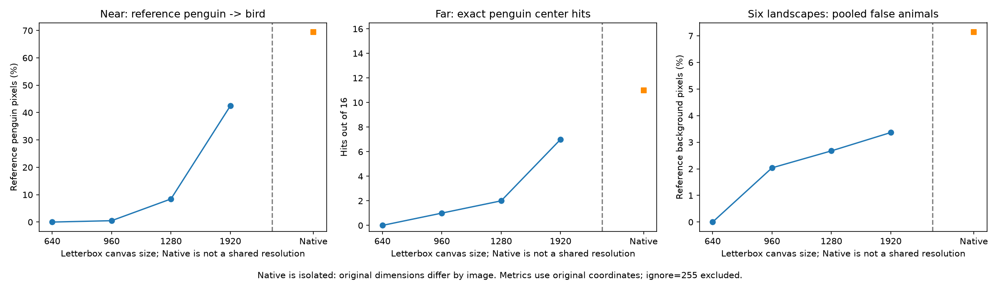

# Experiment 14: Inference Scale Sensitivity

Fixed checkpoint SHA256: `ef619766453cb7e6fa9b33dfcf09d7319258796839dca104f3952abab0e43742`. No training.

Actual single-image inputs: 640/960/1280/1920 centered letterbox canvases and original-pixel Native. Padding RGB=(124,116,104), ImageNet normalization, bilinear RGB resize. Remove padding from continuous logits, bilinearly restore original coordinates, then argmax. Same compact affine-head inference graph at every setting; no fusion, sliding windows or threshold changes.

All model inputs, weights and logits are float32; autocast and both matmul/convolution TF32 are disabled. GPU is attempted first; only CUDA OOM permits CPU float32 at the unchanged requested size. CPU and GPU timings are not interchangeable. Forward and total inference times, preprocessing time, successful-device peaks and failed GPU attempts are separate in the resource logs.

CUDA peaks are PyTorch allocator accounting, not physically resident dedicated VRAM. On Windows/WDDM they can exceed card VRAM while execution becomes much slower; see runtime_environment.json. No GPU memory cap or input reduction was applied.

Observed successful cases: GPU 75, CPU 0. Maximum CUDA allocated peak: 12.83 GiB. Native inference times: 0.17-122.80 seconds per photograph. Times include device placement and first-use costs; they are diagnostic measurements, not steady-state latency benchmarks.

The green square is a 640x640 input-coordinate reference drawn only on preview copies, including padding at 640. It is not the receptive field and does not certify a training-distribution region. Background remains original RGB in overlays; penguin red, other bird orange, seal cyan.

Head/chest and distant ROIs were fixed from original RGB before experiment-14 predictions; coordinates are in protocol.json. Error maps separately show GT-penguin->bird (magenta) and GT-background->bird (yellow). Metrics ignore label 255 and use original image coordinates. Exact existing 16-point hits are not instance recall. Reference bird/seal recall is undefined without positive labels; use animal validation for those classes.

| Setting | Near penguin -> bird | Far penguin point hits | Pooled landscape FP |
|---|---|---|---|
| 640 | 0.00% | 0/16 | 0.00% |
| 960 | 0.50% | 1/16 | 2.04% |
| 1280 | 8.44% | 2/16 | 2.68% |
| 1920 | 42.45% | 7/16 | 3.37% |
| Native | 69.39% | 11/16 | 7.14% |

Native uses a different original resolution for each photograph.

## Diagnostic answers

1. Near penguin-to-bird confusion across 640/960/1280/1920 is non-decreasing: 0.0000%, 0.4959%, 8.4397%, 42.4489%. Native is reported separately (69.3940%).
2. Far point baseline is 0/16 at 640. First tested resized setting with more penguin hits: 960.
   - 640: penguin 0/16; any animal 0/16; pooled landscape FP 0.0000%; far-photo background FP 0.7115%.
   - 960: penguin 1/16; any animal 1/16; pooled landscape FP 2.0374%; far-photo background FP 0.7954%.
   - 1280: penguin 2/16; any animal 2/16; pooled landscape FP 2.6751%; far-photo background FP 0.8910%.
   - 1920: penguin 7/16; any animal 7/16; pooled landscape FP 3.3650%; far-photo background FP 1.1244%.
   - Native: penguin 11/16; any animal 11/16; pooled landscape FP 7.1370%; far-photo background FP 2.8683%.
3. Resized-setting Pareto candidates on the three stated diagnostic axes: 640, 960, 1280, 1920. Intermediate non-dominated candidates: 960, 1280. This is descriptive, with no new classification thresholds or tuning. It does not establish a universal optimum.
4. Opposite per-image trends are present:
   - 640->960, penguin_iou: increases in penguin_colony.jpg, penguins_far.jpg; decreases in penguins_near.jpg.
   - 960->1280, penguin_iou: increases in penguin_colony.jpg, penguins_far.jpg; decreases in penguins_near.jpg.
   - 960->1280, background_fp_fraction: increases in antarctic_landscape_mather_lake.jpg, antarctic_landscape_untitled_2.jpg; decreases in antarctic_landscape_untitled_1.jpeg.
   - 1280->1920, penguin_iou: increases in penguin_colony.jpg; decreases in penguins_far.jpg, penguins_near.jpg.
   - 1280->1920, background_fp_fraction: increases in antarctic_landscape_untitled_1.jpeg, antarctic_landscape_untitled_3.jpg, antarctic_landscape_untitled_4.jpg, antarctic_landscape_untitled_5.jpg; decreases in antarctic_landscape_mather_lake.jpg, antarctic_landscape_untitled_2.jpg.

Completed 75/75 configurations. Failed settings retain their names and reasons; no smaller substitute was used.
Native uses different original sizes, so it is not included in the resized-resolution Pareto ordering. Device/precision records must be considered when reading timings.
These model-assisted development references are not a blind independent test. No inference threshold, fusion, model structure or weights were tuned. Results cannot be attributed directly to a kernel size or crop boundary.

Full 15-image HTML gallery and class masks: `artifacts/experiments/exp14_results/run_20261111_175034/gallery.html`. NJU is visualization only, and all NJU pixels remain under ignored artifacts storage.

Reference protocol: unchanged benchmark_v2; near and far include model-assisted annotations. This is a fixed-weight scale diagnosis, not independent blind-test accuracy or a kernel/boundary causal ablation.
