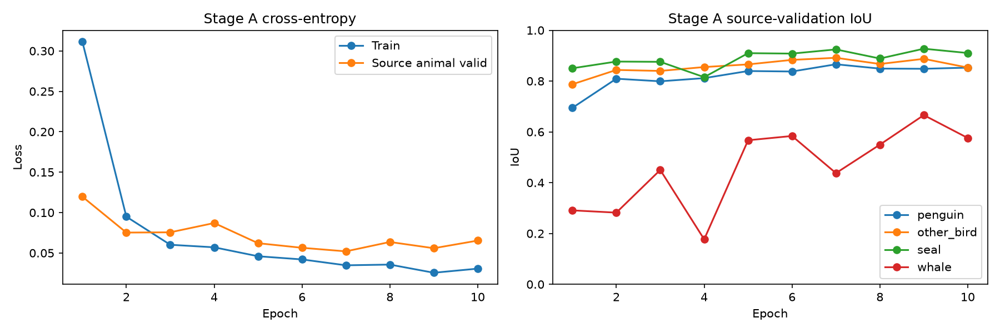

# Experiment 15: five-class source baseline

Method: pseudo-label-assisted human annotation, then target-domain fine-tuning. No ST++ or other named self-training algorithm is claimed. The completed source baseline is retained; proposed target foreground fine-tuning was not executed.

Five classes: background=0, penguin=1, other_bird=2, seal=3, whale=4; ignore=255. ResNet34 U-Net uses kernel 3 and original 7x7 stem. A starts with an ImageNet encoder and random decoder/head, without historical weights. Train ten epochs at 640 letterbox, batch 6 unless real preflight OOM requires 4, AdamW 1e-4/0.01, normal BN, AMP, CE(ignore=255), seed 42, constant LR, 1/sqrt(group_size) image weights with replacement and len(train) draws. Preflight updates are discarded.

## Stage A completed

Epochs: 10; actual batch: 6; selected epoch: 9. Source animal-validation foreground mIoU: **83.23%**. Selection uses all four foreground classes on source animal validation at 640/AMP.

| Class | IoU | Precision | Recall | Dice | Label pixels | Image coverage |
|---|---:|---:|---:|---:|---:|---:|
| background | 97.96% | 98.87% | 99.07% | 98.97% | 503566717 | 1915 |
| penguin | 84.83% | 89.89% | 93.78% | 91.79% | 14688660 | 124 |
| other_bird | 88.74% | 94.90% | 93.18% | 94.03% | 64213713 | 1351 |
| seal | 92.73% | 97.11% | 95.36% | 96.23% | 25689332 | 428 |
| whale | 66.59% | 80.42% | 79.48% | 79.95% | 988421 | 12 |

Source animal pixel accuracy: 98.13%; background -> any animal: 0.93%; background -> bird: 0.56%; background -> whale: 0.03%.

Separate natural-background validation FP: 0.08%; bird FP: 0.07%; whale FP: 0.00%. Foreground metrics are N/A when positive labels are absent.

Best checkpoint SHA256: `20467db167d5dee8605c7dce4a68fe253db80790b48c016a1ab9e2c49fe4807b`. Strict five-class loading passed. Last-minus-best source foreground mIoU: -0.034162.

## Frozen target split and drafts

The RGB-only audit decoded all 167 images; exact-byte and decoded-RGB duplicate counts are zero. The user confirmed 142 train / 25 validation photos, with seven conservative validation scene groups. Same-scene and burst groups do not cross train/validation. The only clearly visible whale was held in validation; source replay supplies whale supervision during B. RGB category hints are not ground-truth labels. The six final NJU test photos are not training or validation inputs.

A draft inference completed for 167 photos (142 train, 25 validation), at fixed 960 centered letterbox, float32, autocast/TF32 off. Crop padding from all five continuous logits, restore original dimensions, then argmax. Checkpoint/image/mask identities and actual input shapes are recorded. No sliding windows, fusion or per-image scale choice; no full-resolution probability arrays are saved.

Training annotation loads unapproved prediction seeds. Validation annotation starts with all-ignore=255 masks; predictions are stored separately and are not served by the validation editor. Save means editing, never approval. Approve is separate and records the exact revision/hash. Original drafts and every edited revision remain available. Uncertain pixels stay ignore.

Current approved annotation counts: train 0/142; validation 0/25.

## Stage B waiting

**Not executed. Waiting for explicit human completion and approved masks. No target-domain IoU, A/B improvement or fine-tuning result is claimed before independent validation labels exist.** B starts from A best, resets AdamW to 1e-5, runs five epochs with each approved target once plus equally many source draws, trains at 640 and evaluates at 960. Source draws keep the five-class inverse-square-root strategy. Partial approval first reports counts/coverage and requires explicit partial-training confirmation; remaining pseudo-labels are never silently included.

## Public-source scope

The completed stage-A model, data audit, fixed 960 inference and metrics remain
available in `scripts/experiment15.py`. Interactive annotation and the unexecuted
stage-B implementation are excluded from the public source. No human correction
completion or target fine-tuning improvement is claimed. Experiment 16 uses
background-only target supervision in a separate protocol; its group B is not
experiment-15 fine-tuning stage B.

[All experiments](../README.md) | [Final five-class experiment](../exp16/README.md)
