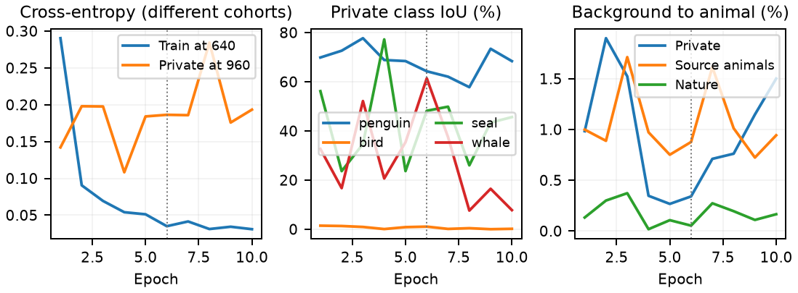
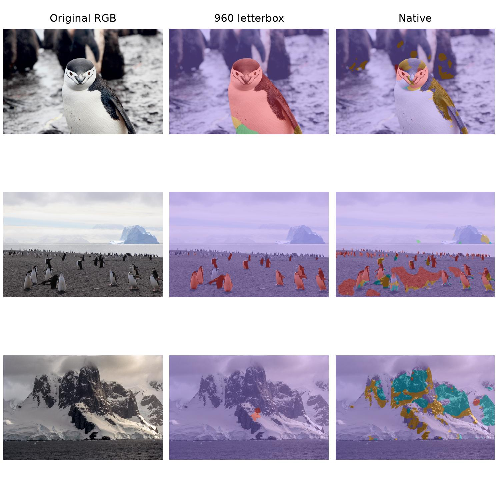

# Experiment 16 - Group B: final five-class submission

Completed: 10 epochs, batch 6, selected epoch 6. The submitted operating setting is fixed **960 letterbox / float32** for all photos. Native is a separate fixed-weight diagnostic, without fusion. Only experiment-16 group B was trained; it is not experiment-15 target fine-tuning stage B.

## Training and data

ImageNet ResNet34 encoder, random decoder/head, five outputs, decoder 3x3 and original 7x7 stem. No historical segmentation initializer. Train at 640 letterbox with AdamW 1e-4, weight decay .01, normal updating BN, AMP, CE(ignore=255), seed 42 and constant learning rate. Batch 6 passed two disposable real preflight steps; formal training discarded those updates and reinitialized.

| Sampling group | Available images | Draw probability | Actual ten-epoch draws |
| --- | ---: | ---: | ---: |
| Penguin | 423 | 11.1% | 9,821 |
| Other Bird | 5,326 | 39.5% | 34,593 |
| Seal | 871 | 16.0% | 13,995 |
| Whale | 385 | 10.6% | 9,123 |
| Nature Background | 1,759 | 5.7% | 4,981 |
| Antarctic Background | 142 | 17.1% | 15,127 |

8,906 images are available; every epoch has exactly 8,764 replacement draws. Each image weight is group probability / group size, uniform within group. These are sampler weights, not loss weights. Background total probability is 22.8%, split Nature:Antarctic 1:3.

The merged animal folders are loaded directly, without original Wildlife or old E15 source snapshots. Whale train contains 344 new HappyWhale/CFR and 41 retained Wildlife records. Existing source splits remain unchanged. Only the background-only derivative of 142 private training photos joins training: whole RGB images are retained, animals/unknowns plus a square safety margin are ignored=255. Native radius is ceil(16 * max(width,height) / 960). Private foreground masks are not training targets. User-confirmed SAM3 references are model-assisted, not independently drawn human ground truth. New source whale labels are also SAM3-derived; SealID masks are approximate.

## Selected checkpoint

| Private validation class | IoU | Precision | Recall | Dice |
| --- | ---: | ---: | ---: | ---: |
| penguin | 64.26% | 97.39% | 65.38% | 78.24% |
| other_bird | 1.06% | 1.08% | 44.36% | 2.11% |
| seal | 48.19% | 82.16% | 53.83% | 65.04% |
| whale | 61.39% | 67.89% | 86.51% | 76.07% |

Private foreground mIoU: **43.73%** at epoch 6; last epoch 10: **30.49%**. Private pixel accuracy: 95.87%. The 25-image target split is validation used for selection, not a blind test. Bird precision is especially poor: much of the predicted bird area is reference penguin or seal. Only one target whale image is present.

| Validation cohort | Images | Protocol | Foreground mIoU | Background to animal | To bird | To seal | To whale |
| --- | ---: | --- | ---: | ---: | ---: | ---: | ---: |
| source_animals | 1958 | 640 / AMP | 84.596% | 0.877% | 0.599% | 0.071% | 0.021% |
| nature | 129 | 640 / AMP | N/A | 0.053% | 0.041% | 0.001% | 0.008% |
| private | 25 | 960 / float32 | 43.726% | 0.341% | 0.060% | 0.159% | 0.017% |

All metrics ignore 255. Numeric precision is derived from saved confusion matrices/per-class arrays: the legacy log field named `precision` also carries the computation dtype, so it is not interpreted as numeric macro precision. No historical training logs are rewritten. Source and private evaluations differ in distribution, resolution and precision; this is not a single-factor domain ablation. Historical four-class mIoU is not directly subtracted from five-class means.

## Fixed-weight Native diagnosis

Both settings cover the same 40 images: two penguin examples, six landscapes, 25 private validation photos, one source whale and six NJU photos. Native preserves original dimensions; float32, autocast/TF32 off. All 40 Native cases completed on CUDA; peak allocated memory was 7.61 GiB. No tiling, threshold adjustment or fusion.

| Setting | Private FG mIoU | Landscape pooled background FP |
| --- | ---: | ---: |
| 960 | 43.73% | 3.59% |
| Native | 12.07% | 8.14% |

Native does not provide an overall improvement. It may recover additional distant centers while increasing animal fragmentation/confusion and background errors. Sixteen far centers use the existing exact single-pixel rule, not instance recall. Landscape metrics pool pixels over the six declared background images. The near/far references are model-assisted development masks, not independent ground truth. No NJU IoU is reported.

Public photo credits: GinjaLouro, [far photo](https://commons.wikimedia.org/wiki/File:Baily%27s_Head_chinstrap_penguin_colony_-_Deception_Island,_Antarctica.jpg), CC BY-SA 4.0; Eamonn Maguire, [near photo](https://commons.wikimedia.org/wiki/File:Chinstrap_Penguin_(Unsplash).jpg), listed CC0 1.0; Jerzy Strzelecki, [landscape](https://commons.wikimedia.org/wiki/File:Antarctic_(js)_29.jpg), CC BY 3.0. Segmentation overlays and layout added. Far-photo derivatives retain CC BY-SA 4.0. No course photographs appear in this public figure.

[Class metrics](class_metrics.csv) | [Per-image metrics](image_metrics.csv) | [Far points](far_points.csv) | [Summary](summary.json)

[All experiments](../README.md). Large predictions, checkpoints and complete private course reports are excluded from the public source. LLM-assisted report code/prose: OpenAI Codex, 2026-11-13.
