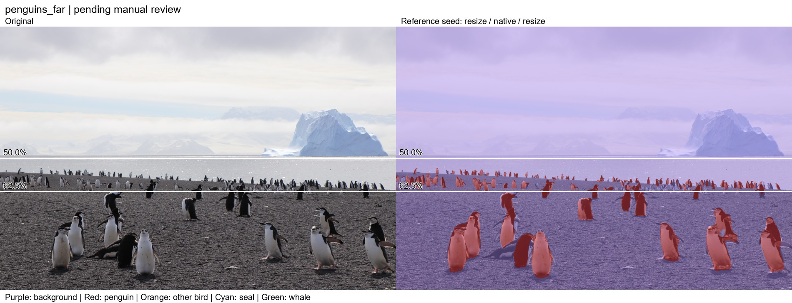

# Reference mask review

Ten public example images have editable reference proposals. These review_v1 proposals are separate from the frozen benchmark_v2 used in experiments 13/14; reviewing a proposal does not authorize overwriting that benchmark. Any future accepted reference change needs a new version. Editor status records the review checkbox and saved revisions. The separate [benchmark_v2 snapshot](benchmark.md) uses the colony edit, the approved far-photo bands, the experiment-11 resize mask for near, and full-background landscape masks. Original proposals and benchmark_v1 remain preserved.

Open `artifacts/reference_review/editor.html` in Edge or Chrome. Click **Open photos** and select the original files in `data/examples/`. Click **Output folder** and choose `data/reference_masks/review_v1/`. The editor reads the current mask revisions from that folder. All processing stays local; no server is needed.

Folder access uses the browser's [File System Access API](https://developer.chrome.com/docs/capabilities/web-apis/file-system-access). Grant access to the reference-mask folder when prompted. PNG download remains available if folder saving is unsupported.

| Images | Initial proposal |
|---|---|
| penguins_far | Resize 0-50%, native 50-62.5%, resize 62.5-100%; class IDs preserved |
| penguins_near | Foreground union; proposed animal labels mapped to penguin |
| penguin_colony | Foreground union mapped to penguin in the 36-60% height band; background elsewhere |
| Six landscapes and one people image | Proposed full-background masks; confirm that target animals are absent |

All proposals can still contain missed animals, false positives, and inaccurate boundaries. Inspect RGB details and correct the masks before accepting them. Horizontal bands are annotation aids, not an inference algorithm.

| Action | Control |
|---|---|
| Paint a class | Select class, then Brush (B) |
| Erase animal labels | Background (0), then paint |
| Fill a polygon | Polygon (P), click vertices, Enter to finish; Esc cancels |
| Fill a rectangle | Rectangle (R), drag |
| Zoom / pan | Mouse wheel / Space + drag |
| Compare with original | Hold H |
| Undo / redo | Ctrl Z / Ctrl Shift Z |
| Save | Ctrl S; check I reviewed this mask only after inspection |

Saving writes a full-resolution class-ID PNG and updates `manifest.json`; previous `.edit_NNN.png` files and `.seed.png` masks are preserved. Values are 0 background, 1 penguin, 2 other bird, 3 seal, 4 whale, and 255 ignored. Uncertain areas can be painted with Ignore (I).

To rebuild the offline editor, run `python scripts/annotate.py --offline` using the project environment. A localhost server is also available through `python scripts/annotate.py`, but the offline editor avoids localhost access restrictions. No training is performed.

Validation: brush/polygon rasterization, background erasing, ignored labels, undo/redo, revision persistence, grayscale mask roundtrip, conflict rejection, and exact far-photo bands passed code-level checks. Browser interaction and the directory permission picker were not verified in the original editor-preparation session; no new browser verification was performed during closeout.

